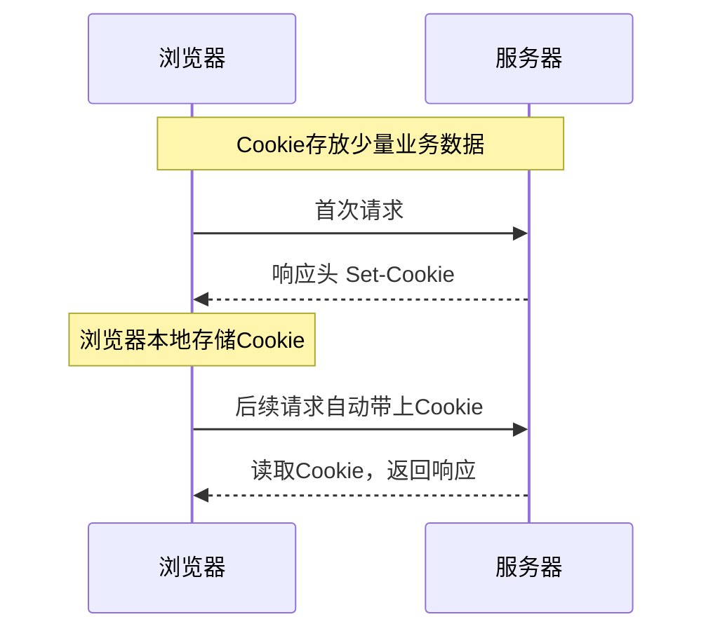
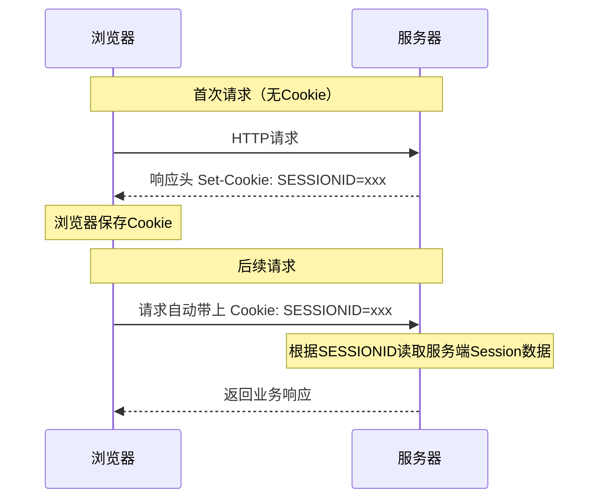

# 个人笔记

## Module使用
### Module分类
- 普通Module
- 全局Module
- 动态Module

### `@Module` 的使用限制
**可见性**
- provider 默认**私有**，只在本模块内可注入；跨模块必须双向配合：提供方 `exports`，使用方 `imports`。
- 兄弟模块互不可见 —— 共同父模块同时 `imports` 两者也不行（你刚才的报错就是这个）。
- 想全局可用：`@Global()`，且仍需在根模块导入一次才生效。

**导出**
- `exports` 只能写本模块的 `providers`，或 re-export 已 `imports` 的模块；**controller 不能导出**。
- 导出 token 必须和 `provide` 的一致：用字符串 token 注册的，就导出字符串。
- `exports` 里写了未注册的 provider 会直接启动报错。

**注册**
- 同一 token 在同一模块重复注册：后者覆盖前者。
- 同一 token 在不同模块各注册一次：**各是独立实例**，不是共享单例；要共享必须从同一个模块导出。
- 一个 controller 只应在一个模块声明，多处声明会重复注册路由。

**依赖**
- `imports` 里只能是带 `@Module` 的类或 `DynamicModule`；模块间循环依赖需要 `forwardRef`。
- 所有 provider 在应用启动时**全部实例化**，没有懒加载 —— 即使没人注入也会执行构造函数。


```ts
// PartialType函数的作用: 传入一个类, 生成新类，所有属性可选
import { PartialType } from '@nestjs/mapped-types';
import { CreateUserDto } from './create-user.dto.js';

export class UpdateUserDto extends PartialType(CreateUserDto) {}
```

```bash
nest --help # 查看nest脚本支持的指令

nest g res user # 生成一个user模块的CRUD模版
```

## 给api加版本
```ts
import { NestFactory } from '@nestjs/core';
import { AppModule } from './app.module.js';
import { VersioningType } from '@nestjs/common';

async function bootstrap() {
  const app = await NestFactory.create(AppModule);
  app.enableVersioning({
    type: VersioningType.URI, // 在uri上携带api版本
    prefix: 'v', // 默认前缀是v
  });
  app.setGlobalPrefix('/api'); // 给请求路径加个公共前缀
  await app.listen(process.env.PORT ?? 3000);
}
await bootstrap();
```
```ts
import {
  Controller,
  Get,
  Version,
} from '@nestjs/common';
import { RoleService } from './role.service.js';

@Controller({
  path: 'role',
  version: '1', // 控制器全局版本
})
export class RoleController {
  constructor(private readonly roleService: RoleService) {}

  @Get()
  @Version('2') // 方法版本
  findAll() {
    return this.roleService.findAll();
  }
}

```

## 如何判断nestjs底层依赖
```text
@nestjs/platform-express，意味着底层是 Express
@nestjs/platform-fastify，意味着底层是 Fastify
```


## 常用装饰器
```ts
import {
  Controller,
  Get,
  Redirect,
  Version,
  Request,
  Response,
} from '@nestjs/common';
import { RoomService } from './room.service.js';
import type { Response as ExpResp, Request as ExpReq } from 'express'; // 底层如果使用的是fastify那就得改了

@Controller('room')
export class RoomController {
  constructor(private readonly roomService: RoomService) {}

  //  @Redirect: 重定向
  @Get()
  @Version('1')
  @Redirect('room/req/2') // 最终的url: @Version('1') + 配置的url
  // @Redirect('/api/v2/room') // 如果我们前缀以/开头, 不受 @Controller('room') + @Version('1')影响
  get1() {
    return { version: 'v1' };
  }

  @Get()
  @Version('2')
  get2() {
    return { version: 'v2' };
  }

  // @Request修饰的参数, 从中能得到一切我想得到的请求数据: query, params, body, headers...
  // 一般我们还是用更细分的 @Query, @Body, @Param, @Headers, @Session来获取更合适
  @Version('1')
  @Get('/req/:id')
  get(@Request() req: ExpReq) {
    console.log();
    // return回去的下面这段内容会被json序列化后返回
    return {
      id: req.params.id,
    };
  }

  // @Next(): 获取将底层的 next 函数注入到控制器方法中。它通常与 Express 风格的中间件逻辑配合使用，用于将控制权传递给下一个处理程序。

  @Get()
  @Version('3')
  // 如果你只是想访问响应对象（例如设置 cookie、自定义响应头），
  // 但仍希望 NestJS 负责序列化返回值和处理状态码，那么必须启用 passthrough 选项。
  get3(@Response({ passthrough: true }) resp: ExpResp) {
    resp.setHeader('LYR', 'MyNameIsLinyerun');
    return {
      name: 'linyerun',
    };
  }
}
```


## Cookie and Session
> Cookie


> Session


---

<p align="center">
  <a href="http://nestjs.com/" target="blank"></a>
</p>

[circleci-image]: https://img.shields.io/circleci/build/github/nestjs/nest/master?token=abc123def456
[circleci-url]: https://circleci.com/gh/nestjs/nest

  <p align="center">A progressive <a href="http://nodejs.org" target="_blank">Node.js</a> framework for building efficient and scalable server-side applications.</p>
    <p align="center">
<a href="https://www.npmjs.com/~nestjscore" target="_blank"></a>
<a href="https://www.npmjs.com/~nestjscore" target="_blank"></a>
<a href="https://www.npmjs.com/~nestjscore" target="_blank"></a>
<a href="https://circleci.com/gh/nestjs/nest" target="_blank"></a>
<a href="https://discord.gg/G7Qnnhy" target="_blank"></a>
<a href="https://opencollective.com/nest#backer" target="_blank"></a>
<a href="https://opencollective.com/nest#sponsor" target="_blank"></a>
  <a href="https://paypal.me/kamilmysliwiec" target="_blank"></a>
    <a href="https://opencollective.com/nest#sponsor"  target="_blank"></a>
  <a href="https://twitter.com/nestframework" target="_blank"></a>
</p>
  <!--[](https://opencollective.com/nest#backer)
  [](https://opencollective.com/nest#sponsor)-->

## Description

[Nest](https://github.com/nestjs/nest) framework TypeScript starter repository.

## Project setup

```bash
$ npm install
```

## Compile and run the project

```bash
# development
$ npm run start

# watch mode
$ npm run start:dev

# production mode
$ npm run start:prod
```

## Run tests

```bash
# unit tests
$ npm run test

# e2e tests
$ npm run test:e2e

# test coverage
$ npm run test:cov
```

## Deployment

When you're ready to deploy your NestJS application to production, there are some key steps you can take to ensure it runs as efficiently as possible. Check out the [deployment documentation](https://docs.nestjs.com/deployment) for more information.

If you are looking for a cloud-based platform to deploy your NestJS application, check out [Mau](https://mau.nestjs.com), our official platform for deploying NestJS applications on AWS. Mau makes deployment straightforward and fast, requiring just a few simple steps:

```bash
$ npm install -g @nestjs/mau
$ mau deploy
```

With Mau, you can deploy your application in just a few clicks, allowing you to focus on building features rather than managing infrastructure.

## Observability

In production applications, observability is essential for understanding how your system behaves, detecting issues early, and maintaining reliable performance.

[NestJS Observe](https://observe.nestjs.com) automatically instruments your NestJS application, giving you deep visibility into your system with minimal setup:

- **Distributed tracing:** Follow requests across services and understand how they flow through your system.
- **Waterfall analysis:** Visualize request execution and identify slow operations, bottlenecks, and unexpected delays.
- **Performance analysis:** Analyze application performance in real time and quickly pinpoint areas that need optimization.
- **Metrics:** Track key application and infrastructure metrics to understand system health and performance trends.
- **Logging:** Centralize and correlate logs with traces and other telemetry to make debugging easier.
- **Error tracking:** Detect errors quickly and investigate their root causes with the surrounding context.
- **SLA monitoring:** Track service-level objectives and identify when your application is approaching or exceeding defined thresholds.
- **Alarms and alerts:** Set up alerts for critical errors, performance degradation, SLA violations, and other anomalies so your team can react quickly.

To add it to this project, run this and approve the code it prints at [observe.nestjs.com/link](https://observe.nestjs.com/link) - signing up for free if you have no account:

```bash
$ npx @nestjs/observe link
```

It installs `@nestjs/observe`, wires it into `AppModule` and `main.ts`, and writes the app key and secret into `.env`, which every `nest start` script (`start`, `start:dev`, `start:debug`) then loads. In production, set `OBSERVE_APP_KEY` and `OBSERVE_APP_SECRET` in the environment instead.

Or do it by hand:

```bash
$ npm install @nestjs/observe
```

Then follow the [setup guide](https://docs.nestjs.com/observability/sdk) - it takes a single import and an app key.

The free plan needs no payment details and covers 300,000 events a month. You can also browse the [live demo](https://www.observe-demo.nestjs.com/dashboard) first - the whole dashboard over a busy service's data, with nothing to install.

## Resources

Check out a few resources that may come in handy when working with NestJS:

- Visit the [NestJS Documentation](https://docs.nestjs.com) to learn more about the framework.
- For questions and support, please visit our [Discord channel](https://discord.gg/G7Qnnhy).
- To dive deeper and get more hands-on experience, check out our official video [courses](https://courses.nestjs.com/).
- Deploy your application to AWS with the help of [NestJS Mau](https://mau.nestjs.com) in just a few clicks.
- Auto-instrument your application with [NestJS Observe](https://observe.nestjs.com). Distributed tracing, metrics, and logging made easy. Error tracking and performance monitoring for your NestJS applications.
- Visualize your application graph and interact with the NestJS application in real-time using [NestJS Devtools](https://devtools.nestjs.com).
- Need help with your project (part-time to full-time)? Check out our official [enterprise support](https://enterprise.nestjs.com).
- To stay in the loop and get updates, follow us on [X](https://x.com/nestframework) and [LinkedIn](https://linkedin.com/company/nestjs).
- Looking for a job, or have a job to offer? Check out our official [Jobs board](https://jobs.nestjs.com).

## Support

Nest is an MIT-licensed open source project. It can grow thanks to the sponsors and support by the amazing backers. If you'd like to join them, please [read more here](https://docs.nestjs.com/support).

## Stay in touch

- Author - [Kamil Myśliwiec](https://twitter.com/kammysliwiec)
- Website - [https://nestjs.com](https://nestjs.com/)
- Twitter - [@nestframework](https://twitter.com/nestframework)

## License

Nest is [MIT licensed](https://github.com/nestjs/nest/blob/master/LICENSE).
